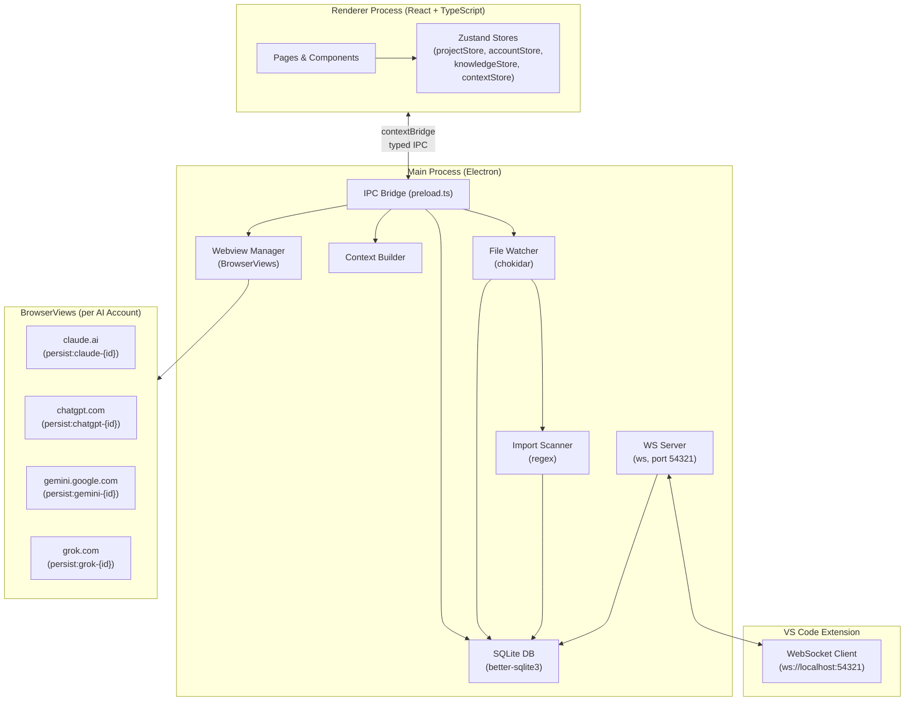

# Design Document: SaKAi Hub

## Overview

SaKAi Hub is a local-first Electron desktop application that serves as a multi-workspace AI development environment. It solves the "re-teach the AI" problem by maintaining persistent, per-project file mirrors and knowledge bases that can be injected into any supported AI provider's web interface — without API keys, proxies, or leaving the actual provider UI.

The application operates entirely on the local machine. All state is stored in a SQLite database via `better-sqlite3`. The only network activity is the embedded AI provider webviews (BrowserViews rendering real provider websites) and the local WebSocket server (port 54321) that communicates with the VS Code extension.

### Key Design Goals

- **Project isolation**: Every piece of per-project data is strictly scoped by `project_id`. AI accounts are the only global entity.
- **Always-current context**: chokidar file watching + import graph construction ensures context reflects the live filesystem.
- **Provider agnosticism**: A per-provider adapter pattern means UI injection logic is isolated and independently maintainable.
- **No API keys required**: Providers are accessed through their web interfaces using isolated Electron session partitions.
- **Correctness by design**: Core data transformations (context assembly, import scanning, token estimation) are deterministic and idempotent.

---

## Architecture

SaKAi Hub follows a standard Electron two-process architecture with a clear main/renderer split. All database access, file system operations, and WebSocket communication live exclusively in the main process. The renderer (React + TypeScript) communicates with the main process via a typed IPC bridge exposed through the preload script.

### High-Level Architecture Diagram



### Process Responsibilities

**Main Process** (`electron/main.ts`):
- Bootstraps the app, creates the BrowserWindow
- Initialises the SQLite database schema on first run
- Registers all IPC handlers
- Manages BrowserView lifecycle for webviews
- Owns the File Watcher, Import Scanner, Context Builder, and WS Server instances

**Preload** (`electron/preload.ts`):
- Exposes a typed `window.api` object to the renderer via `contextBridge`
- All renderer→main calls are named IPC channels; no Node.js APIs leak to the renderer

**Renderer** (`src/`):
- Pure React 18 + TypeScript UI
- State managed by Zustand; stores are reset when a project is switched
- Communicates only through `window.api`

---

## Components and Interfaces

### Main Process Components

#### `electron/main.ts`
Entry point. Responsibilities:
- Create `BrowserWindow` and load the renderer
- Call `initDatabase()` to run schema migrations
- Register all IPC handlers by importing handler modules
- Instantiate `WsServer` and start it
- Manage the lifecycle of `FileWatcher` instances (one per open project)

#### `electron/preload.ts`
Exposes `window.api` with the following typed interface groups:

```typescript
interface Window {
  api: {
    // Projects
    projects: {
      list(): Promise<Project[]>
      create(input: CreateProjectInput): Promise<Project>
      open(id: string): Promise<Project>
      rename(id: string, name: string): Promise<void>
      delete(id: string): Promise<void>
      updateFolderPath(id: string, folderPath: string): Promise<void>
    }
    // Files & Import Graph
    files: {
      list(projectId: string): Promise<ProjectFile[]>
      getImportGraph(projectId: string): Promise<ImportGraph>
    }
    // AI Accounts
    accounts: {
      list(): Promise<AiAccount[]>
      add(input: AddAccountInput): Promise<AiAccount>
      setActive(id: string): Promise<void>
      remove(id: string): Promise<void>
    }
    // Chats
    chats: {
      list(projectId: string): Promise<Chat[]>
      create(input: CreateChatInput): Promise<Chat>
    }
    // Knowledge Cards
    knowledge: {
      list(projectId: string): Promise<KnowledgeCard[]>
      create(input: CreateCardInput): Promise<KnowledgeCard>
      delete(id: string): Promise<void>
      search(projectId: string, query: string): Promise<KnowledgeCard[]>
    }
    // Context Builder
    context: {
      assemble(input: AssembleContextInput): Promise<string>
      estimateTokens(text: string): number
    }
    // Webview / injection
    webview: {
      injectContext(accountId: string, contextBlock: string): Promise<InjectionResult>
      saveKnowledgeFromWebview(payload: SaveKnowledgePayload): Promise<void>
    }
    // Settings
    settings: {
      getApp(): Promise<AppSettings>
      setApp(key: string, value: string): Promise<void>
      getProject(projectId: string): Promise<ProjectSettings>
      setProject(projectId: string, input: ProjectSettingsInput): Promise<void>
    }
    // WS status
    ws: {
      onStatus(callback: (status: WsStatus) => void): () => void
    }
  }
}
```

#### `electron/fileWatcher.ts`
Wraps `chokidar`. One instance per open project.

```typescript
class FileWatcher {
  constructor(projectId: string, folderPath: string, ignorePatterns: string[])
  start(): Promise<InitialScanResult>   // resolves when initial scan finishes
  stop(): Promise<void>                 // stops chokidar watcher within 1s
  updateIgnorePatterns(patterns: string[]): void
}
```

- Debounces change events by 500 ms using a per-file `setTimeout` map
- On each processed event, writes to `project_files` via `db.ts`, then triggers `ImportScanner.scanFile()`
- Pushes IPC event `files:changed` to renderer after each DB write

#### `electron/importScanner.ts`
Stateless utility. Called by `FileWatcher` after each file write.

```typescript
function scanFile(content: string, filePath: string, projectRoot: string): string[]
// Returns array of resolved absolute paths (prefixed "unresolved:" for non-relative)
```

Uses two regex passes:
1. ES module imports: `/import\s+.*?from\s+['"]([^'"]+)['"]/g`
2. CommonJS requires: `/require\s*\(\s*['"]([^'"]+)['"]\s*\)/g`

After scanning, writes the resulting JSON array to `project_files.imports`.

#### `electron/contextBuilder.ts`
Pure function — no side effects, deterministic output.

```typescript
function assembleContext(input: AssembleContextInput): string

interface AssembleContextInput {
  mode: 'smart' | 'selected' | 'full'
  projectFiles: ProjectFile[]
  activeFile?: ProjectFile
  importGraph: ImportGraph
  checkedFileIds: string[]
  checkedCardIds: string[]
  knowledgeCards: KnowledgeCard[]
  ignorePatterns: string[]
  maxTokens?: number
  userMessage?: string
}
```

Section assembly order (empty sections omitted):
1. `## Folder Structure`
2. `## Active File: {filename}`
3. `## Imported Files`
4. `## Recently Changed Files`
5. `## Knowledge Cards`
6. `## User Question`

Each file content block is wrapped as:
````
```{relative/path/to/file}
{content}
```
````

#### `electron/wsServer.ts`
Manages the `ws` WebSocket server on port 54321.

```typescript
class WsServer {
  start(): void
  stop(): void
  getStatus(): 'connected' | 'disconnected'
  onActiveFileChange(handler: (filePath: string) => void): void
  onFileSaved(handler: (filePath: string) => void): void
}
```

Handles two message types from the VS Code extension:
- `{ type: 'active-file', path: string }` → looks up matching project by prefix, updates `is_active`
- `{ type: 'file-saved', path: string }` → triggers File Watcher re-read for that file

#### `electron/webviewManager.ts`
Manages `BrowserView` instances keyed by `accountId`.

```typescript
class WebviewManager {
  show(accountId: string, bounds: Rectangle): void
  hide(accountId: string): void
  injectContext(accountId: string, contextBlock: string): Promise<InjectionResult>
  destroy(accountId: string): void
  destroyPartition(partition: string): Promise<void>
}
```

Uses a provider adapter registry:

```typescript
interface ProviderAdapter {
  model: 'claude' | 'chatgpt' | 'gemini' | 'grok'
  url: string
  inputSelector: string          // CSS selector for chat input
  messageSelector: string        // CSS selector for AI response messages
  injectScript(contextBlock: string): string   // returns JS to execute
  overlayScript(): string        // returns JS to inject Save buttons
}
```

### Renderer Components

#### Pages (`src/pages/`)

| Page | Route / condition | Description |
|---|---|---|
| `ProjectSelector` | initial launch / no active project | Lists all projects sorted by `last_opened_at` desc |
| `Dashboard` | `/dashboard` | AI provider cards (global accounts) + project mirror status |
| `Chat` | `/chat` | 3-column: chat list sidebar / webview / context panel |
| `KnowledgeBase` | `/knowledge` | Card grid with search, filter, multi-select |
| `ProjectSettings` | `/settings/project` | Folder path, ignore list, context defaults, danger zone |
| `AppSettings` | `/settings/app` | Theme toggle, VS Code extension instructions, version |

#### Key UI Components (`src/components/`)

**`Sidebar`**: Collapsible hover sidebar. 56 px collapsed, 240 px expanded. Uses Material Symbols icons. Navigation items: Dashboard (`grid_view`), Chat (`chat_bubble`), Knowledge Base (`psychology`), Project Settings (`folder`). App Settings (`settings`) is pinned at the bottom.

**`ContextPanel`**: Right panel on the Chat screen (260 px). Displays file tree with checkboxes, knowledge card checklist, mode selector (Smart / Selected / Full), live token estimate, and overflow warning banner.

**`SwitchContextModal`**: Dialog shown when switching providers. Shows context preview, token count, and warning if over 80% of context window.

**`ModelSwitcher`**: Dropdown in Chat screen header for switching between AI accounts/providers.

**`KnowledgeCard`**: Card UI with category pill, tags, source model badge, content preview, and delete action.

**`AccountCard`**: Dashboard card for each provider, lists accounts with active indicator and "Add Account" button.

#### Zustand Stores (`src/store/`)

All per-project stores are reset (cleared to initial state) when `projectStore.setActiveProject()` is called with a new project.

```typescript
// projectStore.ts
interface ProjectStore {
  activeProject: Project | null
  projects: Project[]
  setActiveProject(project: Project | null): void
  loadProjects(): Promise<void>
}

// accountStore.ts  (global, not reset on project switch)
interface AccountStore {
  accounts: AiAccount[]
  loadAccounts(): Promise<void>
  addAccount(input: AddAccountInput): Promise<void>
  removeAccount(id: string): Promise<void>
  setActive(id: string): Promise<void>
}

// contextStore.ts  (per-project, reset on switch)
interface ContextStore {
  mode: 'smart' | 'selected' | 'full'
  checkedFileIds: string[]
  checkedCardIds: string[]
  assembledContext: string
  tokenEstimate: number
  setMode(mode: ContextMode): void
  toggleFile(fileId: string): void
  toggleCard(cardId: string): void
  assemble(): Promise<void>
}

// knowledgeStore.ts  (per-project, reset on switch)
interface KnowledgeStore {
  cards: KnowledgeCard[]
  searchQuery: string
  filterCategory: string | null
  loadCards(projectId: string): Promise<void>
  createCard(input: CreateCardInput): Promise<void>
  deleteCard(id: string): Promise<void>
  search(query: string): Promise<void>
}
```

---

## Data Models

### Database Schema (SQLite via better-sqlite3)

All tables are created with `STRICT` mode where supported. Foreign keys are enabled via `PRAGMA foreign_keys = ON` on every connection.

```sql
-- Projects (one per user-defined workspace folder)
CREATE TABLE projects (
  id           TEXT PRIMARY KEY,           -- UUID v4
  name         TEXT NOT NULL CHECK(length(name) >= 1 AND length(name) <= 100),
  folder_path  TEXT NOT NULL,
  created_at   TEXT NOT NULL,              -- ISO 8601 UTC
  last_opened_at TEXT NOT NULL             -- ISO 8601 UTC
);

-- Global application settings (key-value)
CREATE TABLE app_settings (
  key   TEXT PRIMARY KEY,
  value TEXT NOT NULL
);

-- Per-project file mirror
CREATE TABLE project_files (
  id            TEXT PRIMARY KEY,          -- UUID v4
  project_id    TEXT NOT NULL REFERENCES projects(id) ON DELETE CASCADE,
  file_path     TEXT NOT NULL,             -- absolute path
  content       TEXT NOT NULL,
  imports       TEXT NOT NULL DEFAULT '[]',-- JSON array of resolved/unresolved paths
  last_modified TEXT NOT NULL,             -- ISO 8601 UTC from fs.stat
  is_active     INTEGER NOT NULL DEFAULT 0 -- 1 = active in VS Code
);
CREATE INDEX idx_project_files_project_id ON project_files(project_id);
CREATE UNIQUE INDEX idx_project_files_path ON project_files(project_id, file_path);

-- Global AI accounts (no project_id)
CREATE TABLE ai_accounts (
  id                TEXT PRIMARY KEY,      -- UUID v4
  model             TEXT NOT NULL CHECK(length(model) <= 100),
  label             TEXT NOT NULL CHECK(length(label) <= 50),
  session_partition TEXT NOT NULL UNIQUE,  -- persist:{model}-{id}
  is_active         INTEGER NOT NULL DEFAULT 0,
  created_at        TEXT NOT NULL
);

-- Per-project chats
CREATE TABLE chats (
  id         TEXT PRIMARY KEY,             -- UUID v4
  project_id TEXT NOT NULL REFERENCES projects(id) ON DELETE CASCADE,
  model      TEXT NOT NULL,
  account_id TEXT NOT NULL REFERENCES ai_accounts(id),
  title      TEXT NOT NULL DEFAULT 'New Chat',
  created_at TEXT NOT NULL
);
CREATE INDEX idx_chats_project_id ON chats(project_id);

-- Per-project knowledge cards
CREATE TABLE knowledge_cards (
  id             TEXT PRIMARY KEY,         -- UUID v4
  project_id     TEXT NOT NULL REFERENCES projects(id) ON DELETE CASCADE,
  content        TEXT NOT NULL CHECK(length(content) <= 10000),
  category       TEXT,
  tags           TEXT NOT NULL DEFAULT '[]', -- JSON array of strings
  source_model   TEXT,
  source_chat_id TEXT REFERENCES chats(id),
  created_at     TEXT NOT NULL
);
CREATE INDEX idx_knowledge_cards_project_id ON knowledge_cards(project_id);

-- Per-project settings (1:1 with projects)
CREATE TABLE project_settings (
  project_id            TEXT PRIMARY KEY REFERENCES projects(id) ON DELETE CASCADE,
  default_context_mode  TEXT NOT NULL DEFAULT 'smart'
                          CHECK(default_context_mode IN ('smart','selected','full')),
  auto_include_active_file INTEGER NOT NULL DEFAULT 1,
  max_auto_context_tokens  INTEGER,
  ignore_patterns       TEXT NOT NULL DEFAULT '[]' -- JSON array of glob strings
);
```

### TypeScript Domain Types

```typescript
interface Project {
  id: string
  name: string
  folderPath: string
  createdAt: string
  lastOpenedAt: string
}

interface ProjectFile {
  id: string
  projectId: string
  filePath: string
  content: string
  imports: string[]          // resolved absolute paths or "unresolved:..." entries
  lastModified: string
  isActive: boolean
}

interface AiAccount {
  id: string
  model: 'claude' | 'chatgpt' | 'gemini' | 'grok'
  label: string
  sessionPartition: string   // persist:{model}-{id}
  isActive: boolean
  createdAt: string
}

interface Chat {
  id: string
  projectId: string
  model: string
  accountId: string
  title: string
  createdAt: string
}

interface KnowledgeCard {
  id: string
  projectId: string
  content: string
  category: string | null
  tags: string[]
  sourceModel: string | null
  sourceChatId: string | null
  createdAt: string
}

interface ProjectSettings {
  projectId: string
  defaultContextMode: 'smart' | 'selected' | 'full'
  autoIncludeActiveFile: boolean
  maxAutoContextTokens: number | null
  ignorePatterns: string[]
}

type ImportGraph = Map<string, string[]>  // filePath → [importedFilePaths]

interface AssembleContextInput {
  mode: 'smart' | 'selected' | 'full'
  projectFiles: ProjectFile[]
  activeFile?: ProjectFile
  importGraph: ImportGraph
  checkedFileIds: string[]
  checkedCardIds: string[]
  knowledgeCards: KnowledgeCard[]
  ignorePatterns: string[]
  maxTokens?: number
  userMessage?: string
}

interface InjectionResult {
  success: boolean
  method: 'executeJavaScript' | 'clipboard'
  error?: string
}

type WsStatus = { connected: boolean; projectId?: string }
```

---

## Correctness Properties

*A property is a characteristic or behavior that should hold true across all valid executions of a system — essentially, a formal statement about what the system should do. Properties serve as the bridge between human-readable specifications and machine-verifiable correctness guarantees.*

### Property 1: Project name validation accepts valid and rejects invalid inputs

*For any* string input used as a project name, the validation function SHALL accept names of length 1–100 and reject names that are empty or longer than 100 characters, regardless of the string's content.

**Validates: Requirements 1.2, 1.8**

---

### Property 2: Project list sort order invariant

*For any* set of projects with distinct `last_opened_at` timestamps, the list returned by `projects.list()` SHALL be sorted in descending order by `last_opened_at` — that is, for every adjacent pair (a, b) in the returned list, `a.lastOpenedAt >= b.lastOpenedAt`.

**Validates: Requirements 1.5**

---

### Property 3: Project rename round-trip

*For any* project and any valid new name (1–100 characters), after calling `projects.rename(id, newName)`, the project returned by `projects.list()` with that id SHALL have `name === newName`.

**Validates: Requirements 1.11**

---

### Property 4: Referential integrity — project_files foreign key

*For any* attempt to insert a row into `project_files`, `chats`, `knowledge_cards`, or `project_settings` with a `project_id` that does not exist in the `projects` table, the database SHALL reject the insertion with a constraint error and leave the database unchanged.

**Validates: Requirements 2.1, 17.1**

---

### Property 5: Project isolation — no cross-project data leakage

*For any* two distinct projects A and B with disjoint sets of files, knowledge cards, and chats, querying `project_files`, `knowledge_cards`, or `chats` filtered by `project_id = A.id` SHALL return only rows where `project_id = A.id` and SHALL NOT return any row where `project_id = B.id`.

**Validates: Requirements 2.2, 2.3, 2.5, 17.6**

---

### Property 6: Cascade delete removes all per-project rows

*For any* project that has associated rows in `project_files`, `chats`, `knowledge_cards`, and `project_settings`, after deleting that project, queries for each of those tables filtered by the deleted `project_id` SHALL return zero rows. The `ai_accounts` table SHALL be unaffected.

**Validates: Requirements 1.6, 2.6**

---

### Property 7: File scan count equals non-ignored files on disk

*For any* project folder containing N files, where K of those files match the project's active ignore patterns, after the initial scan completes the count of rows in `project_files` for that `project_id` SHALL equal N − K.

**Validates: Requirements 3.1, 3.6, 17.5**

---

### Property 8: File ignore filter invariant

*For any* file whose path matches any pattern in the project's Ignore_List, that file's path SHALL never appear in the `project_files` table after a scan or file-watch event. This holds for default patterns (`node_modules/`, `.git/`, `dist/`, `build/`, `.next/`, `out/`, `coverage/`, `*.log`, `.DS_Store`) and any user-defined custom patterns.

**Validates: Requirements 3.6, 3.7**

---

### Property 9: Import scanner determinism

*For any* file content string, invoking `scanFile(content, filePath, projectRoot)` at any two points in time SHALL produce JSON-identical arrays of import paths (same paths, same order, same resolved/unresolved prefixes).

**Validates: Requirements 17.4, 17.9**

---

### Property 10: Relative import path resolution

*For any* source file at absolute path P within project root R, and any relative import string starting with `./` or `../`, `scanFile` SHALL resolve the import to an absolute path that equals `path.resolve(path.dirname(P), importString)` normalized to the OS path separator.

**Validates: Requirements 4.3**

---

### Property 11: Non-relative imports recorded as unresolved

*For any* import statement whose specifier does not start with `./` or `../` (bare module names, aliased paths, node built-ins), `scanFile` SHALL include that specifier in the imports array with the `"unresolved:"` prefix and SHALL NOT include it as a plain resolved path.

**Validates: Requirements 4.4, 4.7**

---

### Property 12: Active-file routing by folder prefix

*For any* WebSocket `active-file` event containing file path F, if exactly one project has a `folder_path` that is a string prefix of F, then after processing the event `is_active` SHALL be 1 for the row with `file_path = F` in that project and 0 for all other rows in that project. If no project's `folder_path` is a prefix of F, the database SHALL be unchanged.

**Validates: Requirements 5.4, 5.5**

---

### Property 13: Context assembly idempotence

*For any* fixed `AssembleContextInput` value, calling `assembleContext(input)` twice SHALL return byte-identical strings on both calls.

**Validates: Requirements 17.3**

---

### Property 14: Context block section order and empty-section omission

*For any* `AssembleContextInput`, the assembled context string SHALL contain only non-empty sections, and the sections that do appear SHALL appear in the order: Folder Structure → Active File → Imported Files → Recently Changed Files → Knowledge Cards → User Question. No empty section header SHALL appear in the output.

**Validates: Requirements 6.7, 16.1, 16.2**

---

### Property 15: Context file deduplication invariant

*For any* `AssembleContextInput` where the same file path is reachable through multiple selection sources (e.g., checked in Selected_Files_Mode AND referenced as an import in Smart_Auto_Mode), the assembled context string SHALL contain that file's content block exactly once.

**Validates: Requirements 17.10**

---

### Property 16: Context block prepend format

*For any* assembled context block C and user message M (where M is non-empty), `assembleContext(input)` with `userMessage = M` SHALL produce a string that starts with C, contains exactly one blank line between C and the `## User Question` section, and ends with M.

**Validates: Requirements 6.10, 16.4**

---

### Property 17: File code block labeling

*For any* `ProjectFile` included in an assembled context block, the file's content SHALL appear inside a fenced code block whose label is the file's path relative to the project root (e.g., `` ```src/pages/login.tsx ``).

**Validates: Requirements 16.3**

---

### Property 18: Knowledge card content round-trip identity

*For any* string S saved as a Knowledge Card's content, retrieving that card from the database and reading its `content` field SHALL return a string that is byte-for-byte identical to S, with no trimming, escaping, or markup transformation applied.

**Validates: Requirements 17.2, 10.1**

---

### Property 19: Knowledge card deletion consistency

*For any* Knowledge Card that has been successfully deleted, all subsequent queries for `knowledge_cards` filtered by that card's `project_id` SHALL return a result set that does not contain that card's `id`.

**Validates: Requirements 17.7, 10.8**

---

### Property 20: Token estimation accuracy

*For any* text string T, the value returned by `estimateTokens(T)` SHALL satisfy `|estimated − actual| / actual ≤ 0.10`, where `actual` is the token count produced by the cl100k_base BPE tokenizer (tiktoken) applied to T, and where `actual > 0`.

**Validates: Requirements 15.1, 17.8**

---

### Property 21: Context output UTF-8 validity

*For any* `AssembleContextInput` containing files with arbitrary UTF-8 content (including multi-byte characters, emoji, CJK), the assembled context string SHALL be valid UTF-8 and SHALL NOT contain null bytes (`\u0000`) or lone surrogate code points.

**Validates: Requirements 16.5**

---

### Property 22: Selected Files Mode exclusivity

*For any* `AssembleContextInput` in `Selected_Files_Mode` with a set of checked file IDs S, the assembled context block SHALL include content blocks for every file in S and SHALL NOT include content blocks for any file whose ID is not in S.

**Validates: Requirements 6.4**

---

### Property 23: Full Project Mode respect ignore list

*For any* `AssembleContextInput` in `Full_Project_Mode` with an ignore pattern set I, the assembled context block SHALL include content blocks for every project file not matching any pattern in I, and SHALL NOT include content blocks for any file that matches any pattern in I.

**Validates: Requirements 6.5, 6.6**

---

## Error Handling

### File Watcher Errors

| Scenario | Behavior |
|---|---|
| Project folder deleted while watching | Stop watcher, send `files:folderUnavailable` IPC event, show warning banner in Dashboard |
| File unreadable during initial scan (permissions) | Skip file, continue scan, record skip count, display in Dashboard post-scan |
| Malformed file content during import scan | `scanFile` returns `[]`, preserves any existing imports in DB, logs warning |
| Watcher fails to start (invalid path) | Return error from `fileWatcher.start()`, navigate to Project_Selector |

### Database Errors

| Scenario | Behavior |
|---|---|
| FK constraint violation | Propagate error to IPC handler, renderer shows toast notification |
| Knowledge Card save fails | Display error notification, content preserved in renderer state for retry |
| Project delete cascade fails | Display error, leave all data intact (atomic transaction rollback) |
| Project settings save fails | Display error, block navigation away from settings screen |

### Webview / Injection Errors

| Scenario | Behavior |
|---|---|
| `executeJavaScript` injection fails | Copy context to clipboard, show notification with paste instructions |
| "Save to Knowledge" DOM overlay injection fails | Show fallback button in App UI adjacent to webview |
| Webview URL load failure | Show error message in webview area, log to main process |
| Session partition already exists on add | Return error to renderer, show "duplicate account" message |

### VS Code Extension / WebSocket Errors

| Scenario | Behavior |
|---|---|
| WS_Server unavailable on extension activation | Extension retries every 5 seconds |
| `active-file` event for unmatched path | Silently discarded; no DB writes, no error logged |
| WebSocket connection drops mid-session | Extension reconnects every 5 seconds; status bar shows "Disconnected" |
| WS_Server receives connection while no project is open | Reject with descriptive error: "No project currently open" |

### Input Validation Errors

All validation errors are returned from IPC handlers as structured error objects:

```typescript
interface IpcError {
  code: 'VALIDATION' | 'NOT_FOUND' | 'DUPLICATE' | 'DB_ERROR' | 'FS_ERROR' | 'INJECTION_FAILED'
  message: string
  field?: string   // for VALIDATION errors, the field name that failed
}
```

Renderer components handle `IpcError` by displaying field-level errors in forms or toast notifications for non-form operations.

---

## Testing Strategy

### Approach

This feature uses a dual testing approach: property-based tests for universal correctness properties and unit/integration tests for specific behaviors, error conditions, and infrastructure wiring.

The property-based testing library is **[fast-check](https://github.com/dubzzz/fast-check)** (TypeScript-native, no additional runtime dependencies, runs in Node.js without a DOM).

### Property-Based Tests

Each property from the Correctness Properties section maps to one property-based test. Each test runs a **minimum of 100 iterations** via fast-check's `fc.assert(fc.property(...))`.

Tag format for each test:
```typescript
// Feature: sakai-hub, Property {N}: {property_title}
```

**Core testable units** (pure functions, no Electron/SQLite dependencies):
- `contextBuilder.ts` → `assembleContext()`: Properties 13, 14, 15, 16, 17, 21, 22, 23
- `importScanner.ts` → `scanFile()`: Properties 9, 10, 11
- `tokenEstimate.ts` → `estimateTokens()`: Property 20
- `db.ts` (in-memory SQLite): Properties 4, 5, 6, 7, 8, 18, 19
- Validation logic: Properties 1, 2, 3

**Example property test:**
```typescript
// Feature: sakai-hub, Property 13: Context assembly idempotence
it('assembleContext produces identical output on repeated calls', () => {
  fc.assert(
    fc.property(
      arbitraryAssembleContextInput(),
      (input) => {
        const result1 = assembleContext(input)
        const result2 = assembleContext(input)
        expect(result1).toBe(result2)
      }
    ),
    { numRuns: 100 }
  )
})
```

### Unit Tests

Unit tests cover specific behaviors not amenable to property testing:

- **Project creation timestamps** (Req 1.3): Create project, verify `created_at` and `last_opened_at` are within 1 second of call time
- **50-project capacity** (Req 1.9): Insert 50 projects, verify all queryable
- **Debounce behavior** (Req 3.3): Trigger 10 rapid file changes, verify one DB write after 500 ms
- **Token warning threshold** (Req 15.3): Token counts at 79%, 80%, 81% of window limit
- **Switch Context Modal** (Req 7.10): Modal displays token count and context preview
- **Project open failure handling** (Req 13.4): File Watcher start failure navigates to Project_Selector

### Integration Tests

Integration tests run against real SQLite (in-memory) and real `chokidar` watchers on temp directories:

- **File Watcher end-to-end** (Req 3.1–3.12): Create temp dir, create project, verify scan → DB sync → update events
- **WS Server routing** (Req 5.4): Start WS server, connect mock client, send `active-file` events, verify `is_active` flags in DB
- **Context injection** (Req 7.5–7.9): Mock BrowserView, call `injectContext()`, verify `executeJavaScript` called with correct payload
- **Account isolation** (Req 7.3): Create two accounts for same provider, verify session partitions differ
- **Project switch timing** (Req 2.4): Switch between two projects with populated data, verify completion within 3 seconds

### Test Configuration

```typescript
// vitest.config.ts
export default {
  test: {
    environment: 'node',      // no DOM needed for core logic tests
    globals: true,
    coverage: {
      include: ['electron/**/*.ts', 'src/lib/**/*.ts'],
    }
  }
}
```

Fast-check is configured globally to use a fixed seed in CI for reproducibility:
```typescript
fc.configureGlobal({ seed: 42, numRuns: 100 })
```
